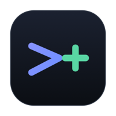
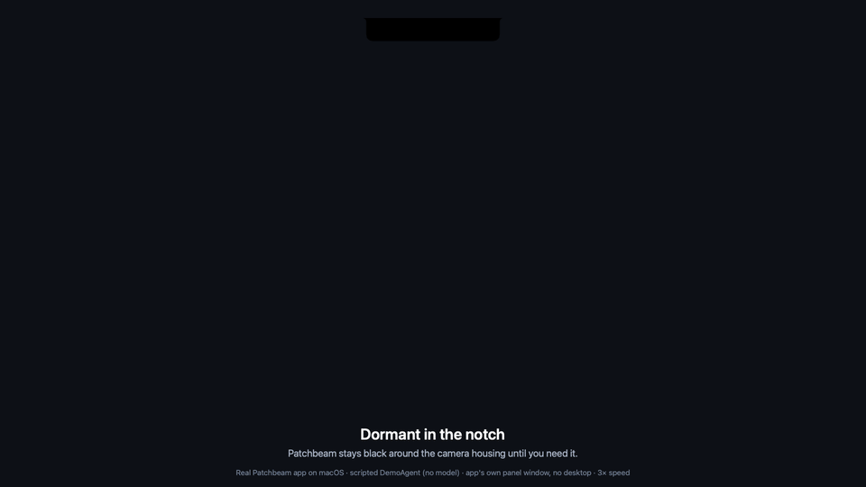
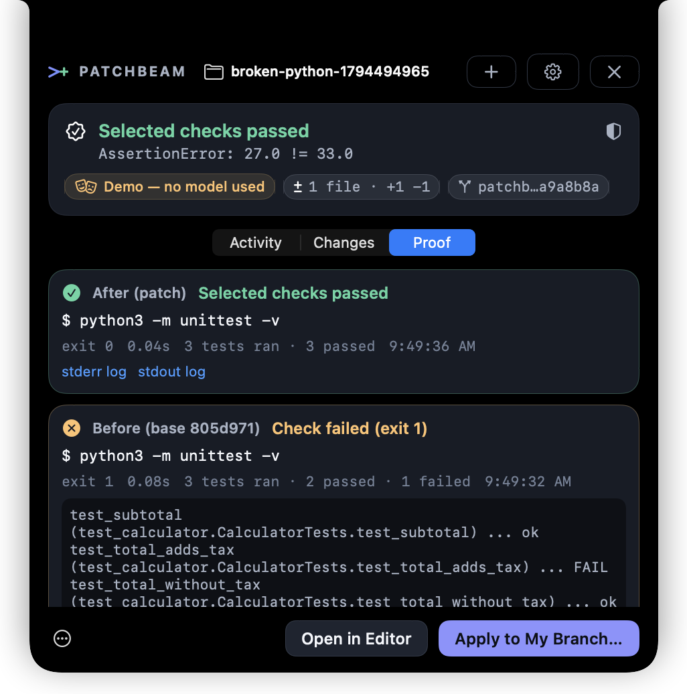
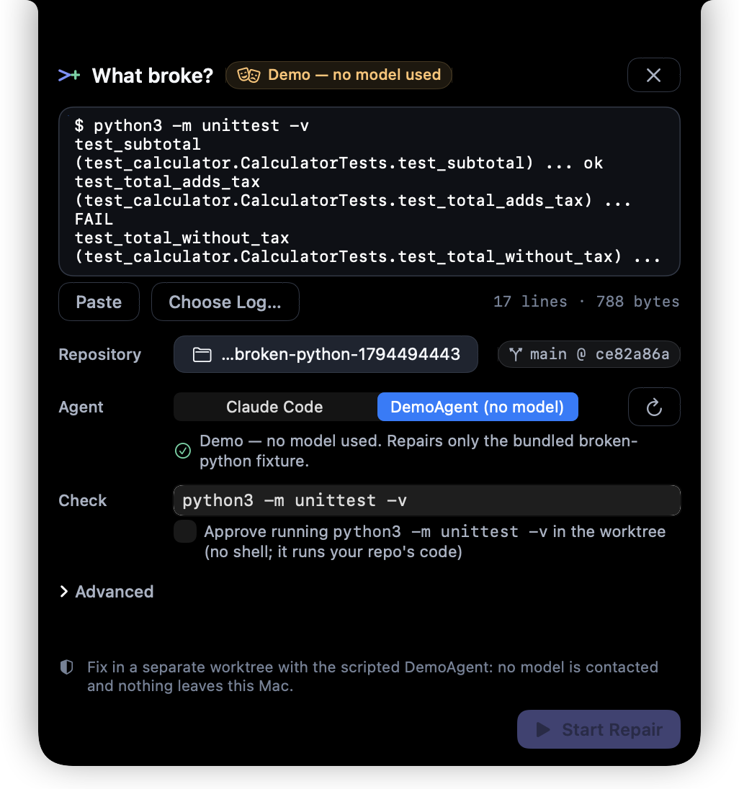
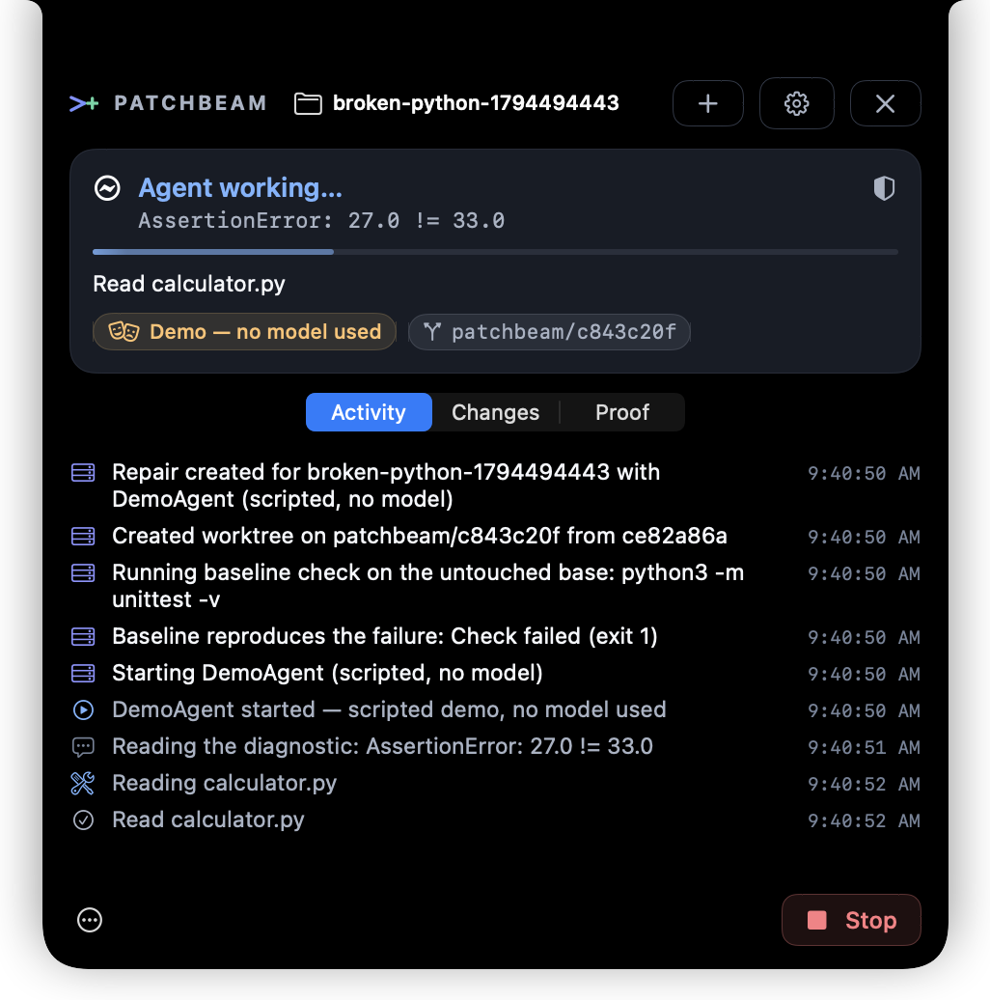
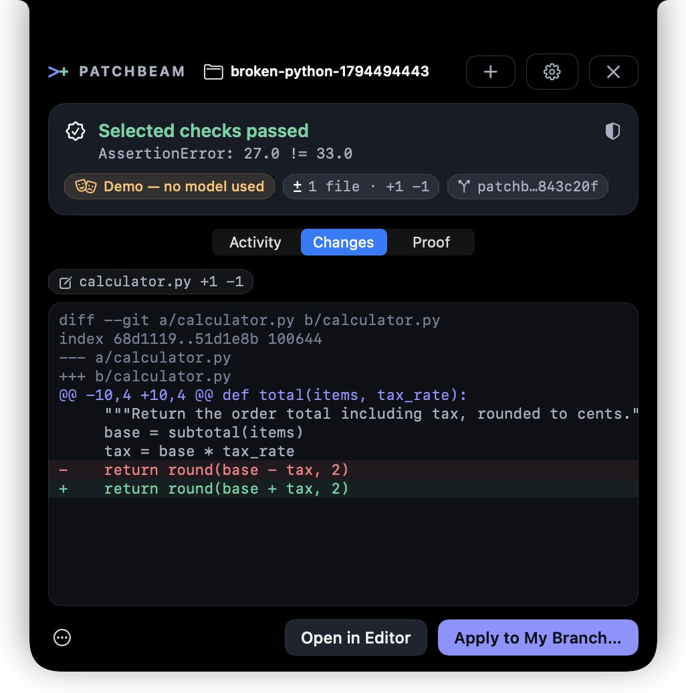
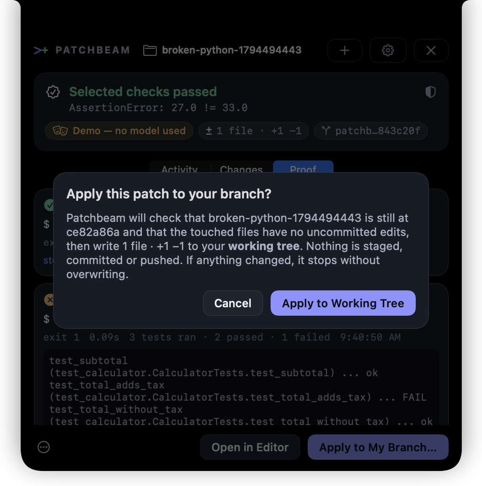
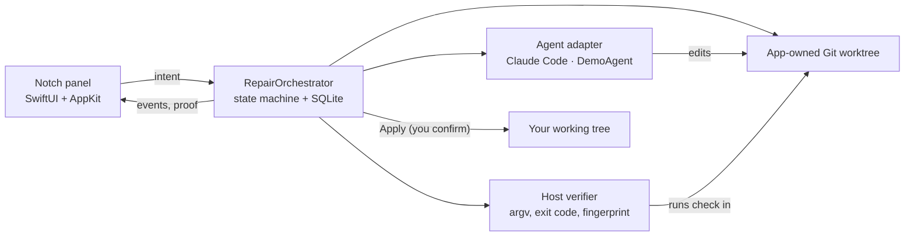

<p align="center">
  
</p>

<h1 align="center">Patchbeam</h1>
<p align="center"><b>From broken to verified, without breaking your flow.</b></p>

<p align="center">
  
  
  <a href="LICENSE"></a>
  <a href="https://github.com/sheehanlloyd/Patchbeam/actions/workflows/ci.yml"></a>
  <a href="https://github.com/sheehanlloyd/Patchbeam/releases"></a>
</p>

<p align="center">
  
</p>

Patchbeam is a small native Mac app that lives in your MacBook's notch. Paste a failing test, and it runs your coding agent in a **separate Git worktree**, runs **your** check command itself, and shows the real exit code and diff. Nothing touches your branch until you click Apply.

<p align="center">
  <a href="https://github.com/sheehanlloyd/Patchbeam/releases"><b>Download preview</b></a> ·
  <a href="docs/media/Patchbeam-Demo.mp4"><b>Watch the real demo (53 s)</b></a> ·
  <a href="#build-from-source"><b>Build from source</b></a>
</p>

---

## Why Patchbeam

`test_total_adds_tax` just failed: `AssertionError: 27.0 != 33.0`. You could stop what you're doing, open a chat, paste, wait, copy code back, and re-run the tests yourself. Or you press <kbd>⌃⌥Space</kbd>, paste the traceback, and keep working. A minute later the notch says **Selected checks passed** and shows a one-line diff, the command it ran, and `exit 1 → exit 0`. You decide whether to apply it.

## See it work



[`Patchbeam-Demo.mp4`](docs/media/Patchbeam-Demo.mp4) (53 s, real time) is a complete run of the app on this repo's bundled `broken-python` fixture. Chapter times come from the app state recorded for each frame ([chapters.txt](docs/media/chapters.txt)):

- **0:00** Dormant island, then glance
- **0:07** Intake: traceback, freshly generated fixture repo, DemoAgent, check approval
- **0:12** Worktree created, baseline check **fails (exit 1)**, agent edits `calculator.py`
- **0:16** Patchbeam runs the check: **exit 0**, *Selected checks passed*
- **0:24** Changes: the Git diff
- **0:29** Proof: after (exit 0, 3 passed) next to before (exit 1)
- **0:35** Explicit apply confirmation → **0:39** applied to the working tree, nothing committed

A second clip, [`Patchbeam-Agent-Run.mp4`](docs/media/Patchbeam-Agent-Run.mp4) (38 s, real time), shows the same flow with **real Claude Code 2.1.322** doing the edit. Patchbeam still runs the check itself.

Every frame is Patchbeam's own panel window, rendered by the running app while it did the real work (real Git, real `python3 -m unittest`, real apply). Captions come from the app state recorded for each frame. The agent in the main video is the **scripted DemoAgent (no model)**. The agent clip is labeled as a live Claude Code run. Each video names its agent on every frame. How the media is made, and what it doesn't show, is in [ADR-0003](docs/adr/0003-self-rendered-media.md).

<br clear="right">

## What makes it different

| From error | Isolated agent | Real proof | You decide |
|---|---|---|---|
| Paste a traceback or drop a `.log` on the notch. ANSI noise is stripped and likely secrets are flagged before anything is sent. | The agent works in an app-owned `git worktree` on a `patchbeam/<id>` branch. Your files and uncommitted edits are untouched. | Patchbeam runs your approved check without a shell. **Selected checks passed** appears only for exit 0 on the exact patch you're looking at. Edit a file and the badge is revoked. | **Apply** writes to your working tree only after checking the base commit and dirty files. It never commits, pushes or merges. |
|  |  |  |  |

## Quick start

**Fastest honest path: build from source (about 2 minutes on an M-series Mac with Xcode installed).**

```bash
git clone https://github.com/sheehanlloyd/Patchbeam.git
cd Patchbeam
./scripts/bootstrap.sh --check
./scripts/build.sh release
open build/Release/Patchbeam.app
```

Then open the menu bar icon and choose **Try the Demo Repair (no model)**, or press <kbd>⌃⌥Space</kbd>.

**Prebuilt preview:** the [Releases](https://github.com/sheehanlloyd/Patchbeam/releases) page has an **unsigned development preview** DMG. It isn't signed with a Developer ID or notarized. See [Installation](#installation).

## System requirements

| | Tested | Notes |
|---|---|---|
| macOS | 26.5.1 (build host); CI on macOS 15 | Minimum deployment target macOS 15 |
| Hardware | MacBook Pro 14" (Mac16,8), Apple silicon, built-in notch | No notch? You get a floating capsule below the menu bar |
| Toolchain | Xcode 26.6 / Swift 6.3.3; CI on Xcode 16 | Swift 6 language mode |
| Git | 2.51.0 | Any recent Git with `worktree` |
| Python | 3.14.7 | Only for the bundled fixture (standard library only) |
| Agent (optional) | Claude Code 2.1.252 | See [Provider support](#provider-support) |

## Installation

### From the preview DMG (unsigned)
1. Download `Patchbeam-0.1.0-arm64-unsigned-preview.dmg` and its `.sha256` from [Releases](https://github.com/sheehanlloyd/Patchbeam/releases).
2. Verify it: `shasum -a 256 -c Patchbeam-0.1.0-arm64-unsigned-preview.dmg.sha256`
3. Open the DMG and drag **Patchbeam** into **Applications**.
4. The first time, Control-click Patchbeam → **Open** → **Open**. (It's ad-hoc signed, not notarized. Please don't disable Gatekeeper globally.)

There's no Homebrew cask yet. One will be added only after a signed, notarized release exists.

### Build from source
```bash
./scripts/build.sh release        # → build/Release/Patchbeam.app (+ build/Release/patchbeam-cli)
open build/Release/Patchbeam.app
```
Use `./scripts/build.sh debug` for `build/Debug/Patchbeam.app`. Set `PATCHBEAM_HOME=/some/dir` to keep Patchbeam's data somewhere other than `~/Library/Application Support/Patchbeam`.

## First fix tutorial

1. See the bug for yourself, headless and fully offline:
   ```bash
   ./scripts/fixture-demo.sh --headless
   ```
   This creates a fresh repo from `Tests/Fixtures/broken-python` in a temp folder, shows `python3 -m unittest -v` **exiting 1**, repairs it in a worktree with the scripted DemoAgent, shows **exit 0**, checks that the source is still broken, then applies and confirms that `HEAD` didn't move and nothing was staged. It ends with `RESULT: PASS`.
2. In the app: menu bar icon → **Try the Demo Repair (no model)**. Patchbeam creates a fixture repo in its own folder and fills in Intake.
3. Tick **Approve running `python3 -m unittest -v` in the worktree**, then click **Start Repair** (<kbd>⌘↩</kbd>).
4. Watch Activity, then look at **Changes** and **Proof**. Click **Apply to My Branch…** and confirm.
5. For your own project, choose a repository, type its check command, approve it, and pick **Claude Code** as the agent.

## Keyboard shortcuts

| Shortcut | Action |
|---|---|
| <kbd>⌃⌥Space</kbd> | Open/close Patchbeam (global; conflicts are reported in Settings → General) |
| <kbd>⌘↩</kbd> | Primary action (Start Repair, Apply…, Retry) |
| <kbd>⌘.</kbd> | Stop the running agent |
| <kbd>⌘1</kbd> / <kbd>⌘2</kbd> / <kbd>⌘3</kbd> | Activity / Changes / Proof |
| <kbd>⌘N</kbd> | New repair |
| <kbd>⇧⌘V</kbd> | Paste the clipboard into Intake |
| <kbd>Esc</kbd> | Close the frontmost transient thing (confirmation, message, intake, panel). It never stops an agent. |

Drag and drop has a keyboard alternative (**Paste**, **Choose Log…**). The shortcut isn't customizable yet.

## Privacy and safety

- **A worktree isn't a sandbox.** It isolates Git state, not files or network. Claude Code runs under its own account and policy. Patchbeam narrows it to `Read,Edit,Write` tools with `--restricted` and no MCP, but can't enforce your provider's behavior.
- **You see what's sent.** The provider receives the diagnostic you reviewed in Intake and can read files in the worktree. The DemoAgent sends nothing.
- **Nothing silent.** No auto-commit, push, merge or PR. No telemetry. No Accessibility, Screen Recording or Full Disk Access permissions. Repository hooks are disabled for every Git command Patchbeam runs.
- Details: [docs/SECURITY.md](docs/SECURITY.md) · [docs/PRIVACY.md](docs/PRIVACY.md)

## Provider support

| Provider | Run | Stream | Approve | Resume | Tested version | Status |
|---|---|---|---|---|---|---|
| **Claude Code** (headless `stream-json`) | ✓ | ✓ | ✗: approve in Claude Code's terminal | ✗ | 2.1.322 (live); 2.1.252 (stream contract) | **Live repair verified** on the fixture, both in the app and via `patchbeam-cli run`: baseline exit 1 → Claude Code edits `calculator.py` → host check exit 0 → applied. About $0.05 per run. Contract tests use real captured streams (signed-in success, plus signed-out on both versions). |
| DemoAgent (scripted, no model) | ✓ | ✓ | ✓ (scripted request) | ✗ | built-in | Repairs only the bundled fixture. Always labeled “Demo — no model used.” |
| Codex app-server | — | — | — | — | — | Not built. The build host's Codex install is broken (missing native binary). See [ADR-0002](docs/adr/0002-claude-code-first-provider.md). |

Live provider smoke test (after `claude auth login`; spends from your provider account, capped by `--budget`; about $0.05 on the fixture):
```bash
./scripts/build.sh release
build/Release/patchbeam-cli fixture --into /tmp/pb-live         # pristine broken repo + a real traceback.log
build/Release/patchbeam-cli run --provider claude-code --repo /tmp/pb-live/broken-python-demo \
  --diagnostic-file /tmp/pb-live/traceback.log --check "python3 -m unittest -v" --budget 0.50 --yes
```
`run` prints its plan first and does nothing without `--yes`. It never applies unless you also pass `--apply` and the checks passed.

## Architecture


The SwiftUI panel sends intent to the orchestrator. The orchestrator creates a worktree, runs the agent there, runs your check itself, and reports events and proof back to the panel. Only a confirmed Apply touches your working tree. Full details: [docs/ARCHITECTURE.md](docs/ARCHITECTURE.md).

## Building and testing from source

```bash
./scripts/bootstrap.sh --check        # prerequisites; installs nothing
./scripts/test.sh                     # 115 tests: unit, Git integration, golden path, provider contracts
./scripts/fixture-demo.sh --headless  # also: --scenario wrongFixThenFix | approval
./scripts/build.sh release            # app bundle + CLI
./scripts/record-demo.sh              # re-record docs/media from the real app
./scripts/release.sh                  # signed+notarized only if credentials exist; otherwise unsigned preview DMG
```
CI runs the same commands on `macos-15` for every push and PR. Problems? See [docs/TROUBLESHOOTING.md](docs/TROUBLESHOOTING.md).

## FAQ

**My Mac has no notch.** Patchbeam shows a small floating capsule centered below the menu bar. It never draws a fake notch.

**What does it cost?** Patchbeam is free (MIT). Real repairs use your own provider account. Each run is capped with `--max-budget-usd` (default $1.00, Settings → Agents).

**Can I use Cursor, VS Code or Zed?** Yes, for review. **Open in Editor** opens the worktree in Cursor, VS Code, Zed or Xcode (whichever is installed, or the one you pick). Agents other than Claude Code aren't supported yet.

**How do I remove all data?** Settings → Privacy → Delete All Local History, or delete `~/Library/Application Support/Patchbeam`. See [PRIVACY.md](docs/PRIVACY.md).

**Which permissions does it need?** None. No Accessibility, Screen Recording or Full Disk Access.

**Does it work offline?** The DemoAgent path is fully offline. Real agents need their provider.

**Why no auto-merge or auto-commit?** Passing the selected checks doesn't prove a fix is right. You review the diff and decide.

## Contributing, security, license

[CONTRIBUTING.md](CONTRIBUTING.md) · [SECURITY.md](SECURITY.md) · [CHANGELOG.md](CHANGELOG.md) · [MIT License](LICENSE) · Quality status: [docs/QUALITY_REPORT.md](docs/QUALITY_REPORT.md)

Patchbeam is an independent project. “Patchbeam” is a provisional name. Claude Code is a product of Anthropic and is used here only through its documented CLI.
