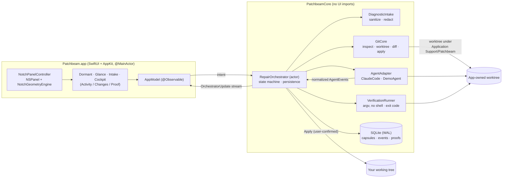

# Architecture

Patchbeam is a native macOS app: SwiftUI views hosted in an AppKit `NSPanel`, over a UI-free core library. Nothing runs in a browser and there's no web backend.



*Text version of the diagram:* the panel's views read `AppModel` and send user intent to `RepairOrchestrator`. The orchestrator owns every state change. It inspects the repo, creates an app-owned worktree, starts an agent adapter (whose events it normalizes), snapshots the diff, runs the approved check itself, and persists each transition before publishing it back to the UI. Only an explicit, confirmed Apply touches your working tree.

## Modules

| Path | Responsibility |
|---|---|
| `Sources/PatchbeamCore/Geometry` | `NotchGeometryEngine`: notch rect from `safeAreaInsets` + `auxiliaryTopLeft/RightArea`; panel frames per presentation; screen selection and re-homing. Pure and unit-tested. |
| `…/Capsules` | `Capsule`, `VerificationRecord`, `PatchArtifact`, `ApprovalRequest`; `CapsuleStateMachine` transition table with the proof guard. |
| `…/Persistence` | Minimal SQLite wrapper; `CapsuleStore` actor with append-only migrations and a transition audit table. |
| `…/Diagnostics` | ANSI/C1/bidi stripping, head+tail truncation, secret scanner with bounded regexes, title inference, project suggestion. |
| `…/GitCore` | `GitClient` (hooks and fsmonitor disabled on every call), `RepositoryInspector`, `WorktreeManager`, `DiffService` (throwaway index), `ApplyService` (fail-closed). |
| `…/Verification` | `CommandLineParser` (quoting, no shell features), `VerificationRunner`, test-output parsers. |
| `…/Agents` | `AgentAdapter` protocol, `AgentEvent` schema v1 + `EventSequencer`, `ClaudeCodeAdapter` + `ClaudeStreamParser`, `DemoAgentAdapter`, `FixtureLibrary`, `RepairPrompt`. |
| `…/Orchestration` | `RepairOrchestrator`: the golden-path pipeline, user actions, launch reconciliation. |
| `…/Infrastructure` | `ProcessRunner` (posix_spawn, own process group, capped output, timeout/cancel), `AppPaths`, `MinimalEnvironment`, `PathSafety`, `PatchbeamError`. |
| `Sources/PatchbeamApp` | Panel/controller, hotkey (Carbon), status item, views, settings, onboarding, `EvidenceRecorder`, `AutoDemo`. |
| `Sources/PatchbeamCLI` | `patchbeam-cli demo --headless`, `probe`, `run`. |

## Capsule lifecycle

```mermaid
stateDiagram-v2
  [*] --> draft
  draft --> ready
  ready --> preparingWorktree
  preparingWorktree --> queued
  queued --> running
  running --> awaitingApproval
  awaitingApproval --> running
  running --> verifying
  running --> reviewReadyUnverified: no check
  verifying --> reviewReadyVerified: exit 0 for this fingerprint
  verifying --> reviewReadyFailed: non-zero / timeout
  verifying --> reviewReadyUnverified: no tests ran / check changed files
  reviewReadyFailed --> retrying: one user-approved retry
  retrying --> running
  reviewReadyVerified --> applied
  reviewReadyVerified --> reviewReadyUnverified: files changed after proof
  reviewReadyUnverified --> applied
  running --> cancelling
  cancelling --> cancelled
  running --> interrupted: app quit/crash
  interrupted --> reconciling --> needsRestart
```

`reviewReadyVerified` can only be entered with a `VerificationRecord` of kind `.patch`, result `.passed`, exit code 0, for the same capsule, whose `patchFingerprint` equals the capsule's current patch fingerprint (`CapsuleStateMachine.transition`). Model text can't satisfy that guard.

## Key invariants (and where they're tested)

| Invariant | Test |
|---|---|
| No repo hook runs during Patchbeam's Git operations | `GitIntegrationTests.repositoryHooksNeverRun` |
| Source checkout untouched until Apply; Apply never commits or stages | `GoldenPathTests.journeyA_redToGreenThenExplicitApply` |
| Apply pauses if HEAD moved, or touched files are dirty | `applyPausesWhenUserBranchMoved`, `applyRefusesToOverwriteDirtyFiles` |
| Proof revoked when files change after verification | `editingAfterVerificationBlocksApply` |
| A check that edits tracked files can't prove anything | `checkThatMutatesFilesInvalidatesProof` |
| No shell interpretation of commands | `CommandParserTests.rejectsShellFeatures`, `ProcessRunnerTests.argumentsAreNotShellInterpreted` |
| Stop kills the agent's process group | `ProcessRunnerTests.timeoutKillsProcessGroup`, `ClaudeAdapterTests.cancelStopsTheProcessGroup` |
| Crash leaves `needsRestart`, never success | `journeyE_restartMarksInterruptedAndPreservesWorktree` |

## Data on disk

`~/Library/Application Support/Patchbeam/` (or `$PATCHBEAM_HOME`):

```
patchbeam.sqlite          capsules, events, verifications, transitions (WAL)
Worktrees/<capsule-id>/   app-owned git worktrees (branch patchbeam/<short-id>)
Capsules/<capsule-id>/    patch-<fp>.diff, verify-*-stdout/stderr.log, agent-stream-*.jsonl
DemoRepos/                fixture repos created by "Try the Demo"
```
